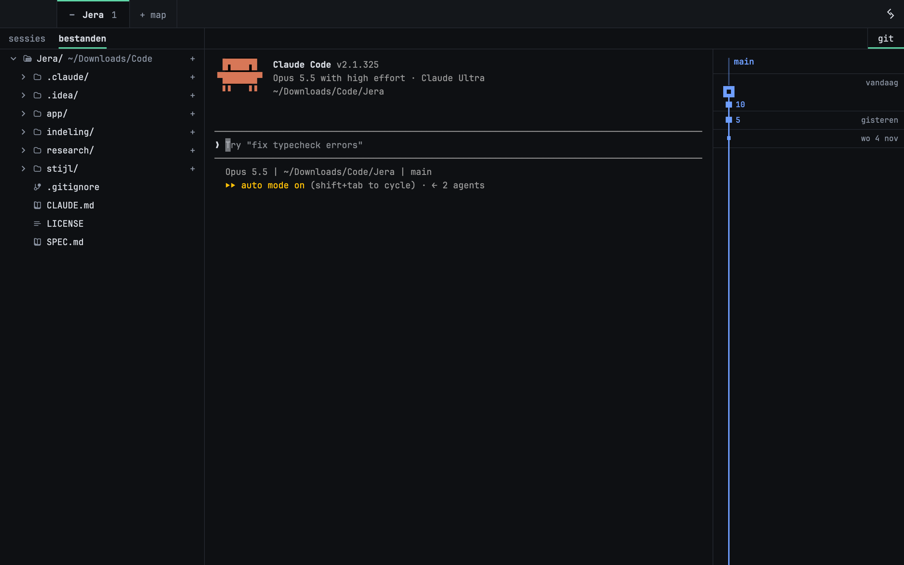
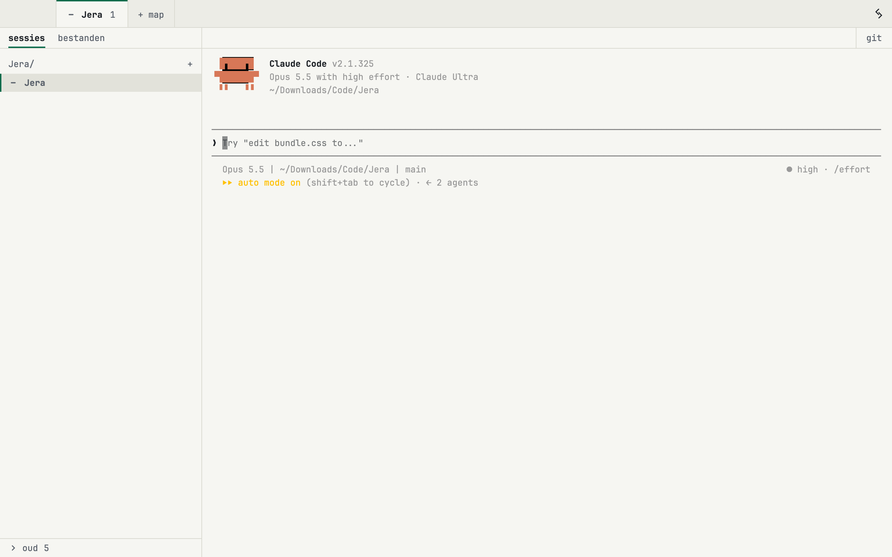

<p align="center">
  
</p>

<h1 align="center">Jera</h1>

<p align="center">
  <b>A native Rust ADE for Claude Code.</b><br>
  All your Claude Code sessions, their status, your files and git in one fast Mac window.<br>
  No Electron. No browser. No IDE.
</p>

<p align="center">
  
</p>

---

## Why

Claude Code does the work: it writes the code, runs the servers, commits and deploys. What's left for you is keeping track of it. With seven sessions open across three projects, the questions are always the same:

- Which session is waiting for me?
- Which one is still working, and which one just finished?
- What did I do in this project yesterday?

IDEs were built for writing code, not for watching agents write it. Jera is built for the second job. It's an **Agent Development Environment**: a home for your sessions, with everything else kept out.

## What you get

**Sessions with live status.** One tab per git repo, with sessions grouped by folder. Each session shows the title Claude Code gives it and an icon for its state:

| | |
|---|---|
| working | green spinner |
| waiting for an answer | yellow question mark |
| waiting for permission | red lock |
| just finished | green check |
| idle | grey dash |

Switch to the file tree and the Sessions tab gets a dot as soon as a session needs you.

**A real terminal.** It's built on `alacritty_terminal` (the core of Alacritty, also used by Zed), with a renderer written from scratch on the GPU. Claude Code's UI renders exactly as it should.

**Subagents and team members.** Expand a session to see the agents it started and how far along they are.

**Old sessions, one click away.** Past conversations for each project, grouped by day. Click one to continue it in a new terminal.

**Files.** A project tree with icons (monochrome or colour). Click a file to open it in its default macOS app. Copy, paste, rename and Trash it from a right-click menu, or start a new session in any folder.

**Git at a glance.** A narrow, collapsible panel with the branch graph of the current repo, next to the terminal.

**Open, clone, start.** `⌘O` opens recent projects, a folder picker, or your GitHub repos (via `gh`) to clone. `⌘N` creates a new project, runs `git init` and starts a session in it.

**Light and dark.** It follows macOS. Square corners, JetBrains Mono everywhere, 26 px rows: dense and calm.

<p align="center">
  
</p>

## What it deliberately isn't

- **Not a browser.** Links open in Safari.
- **Not a document viewer.** Files open in the app macOS already uses for them.
- **Not an IDE.** Keep your editor for debugging. Jera is where the agents live.

## Built with

- [GPUI](https://github.com/zed-industries/zed), the GPU-accelerated UI framework behind Zed, with [GPUI Kit](https://github.com/longbridge/gpui-kit)
- [`alacritty_terminal`](https://crates.io/crates/alacritty_terminal) for terminal emulation
- Pure Rust, about 5,500 lines

Jera works out what a session is doing by reading the files Claude Code itself writes. It needs no hooks, no wrapper and no changes to your setup. How that works is measured and written down in [`research/sessies.md`](research/sessies.md) and [`research/agents.md`](research/agents.md).

## Getting started

Requirements: macOS, [Rust](https://rustup.rs), [Claude Code](https://docs.claude.com/en/docs/claude-code) (`claude` on your `PATH`), and optionally the [GitHub CLI](https://cli.github.com) for cloning.

```sh
git clone https://github.com/wiebe-dejong/Jera.git
cd Jera

# Run it, with a Claude session in each folder you pass
cargo run --release --manifest-path app/Cargo.toml -- ~/code/my-project

# Or build Jera.app into /Applications
app/bundel.sh
```

## Status

Early, and built for one person's workflow first. Expect rough edges. The interface comes in Dutch and English (Jera › Language).

Coming next:
- Tab works inside a session
- Git commands from the UI, not just the graph
- Several Claude sessions in one view
- A project stays open when it has no sessions
- Browser and ports: every listening port (open or kill) and running `agent-browser` instances

Every design decision is recorded in [`SPEC.md`](SPEC.md).

## Name

**ᛃ Jera** is the rune for *harvest*: the year's work coming in.

## License

[MIT](LICENSE). The bundled fonts and icons keep their own licenses: JetBrains Mono (OFL), GitLab, Catppuccin, and Zed/Lucide icons, each with its license file in [`app/`](app/).
